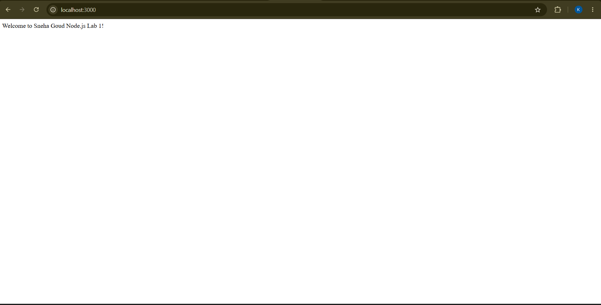
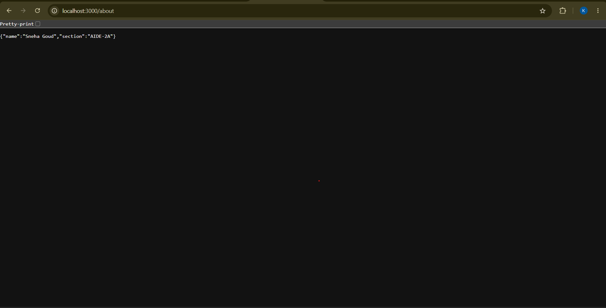
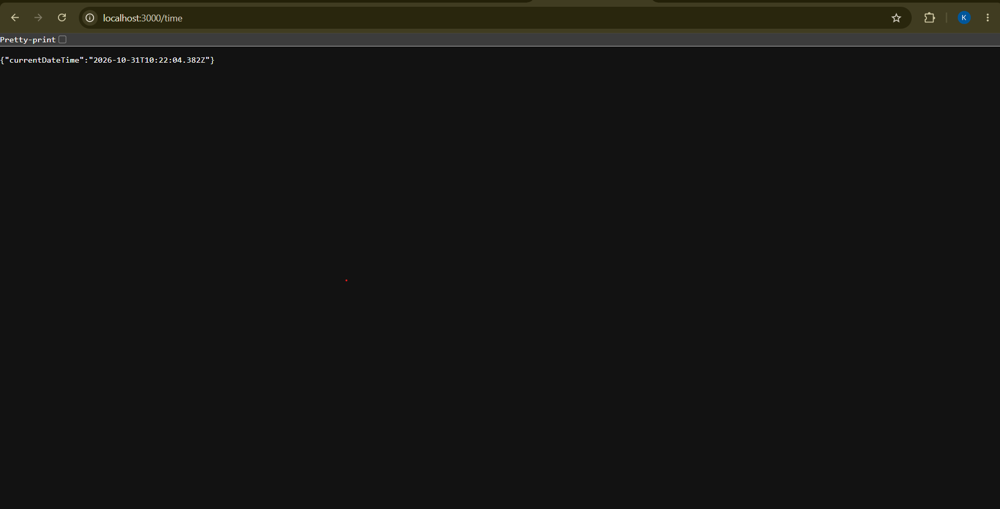
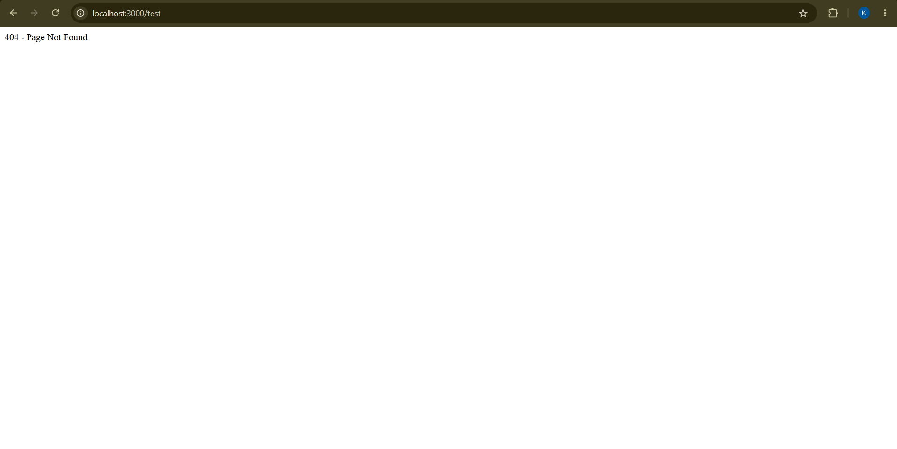

# Node.js and Express Server – Lab 1

## Student Details
- **Name:** Sneha Goud
- **Section:** AIDE-2A
- **Subject:** Backend Development Fundamentals
- **Lab:** 1 – Node.js and Express Server

## Project Description
This project demonstrates how to create a basic HTTP server using Node.js and how to build a web server using Express.js.

## Technologies Used
- Node.js
- Express.js
- JavaScript
- Visual Studio Code

## Installation

1. Install Node.js.
2. Open the project folder in VS Code.
3. Open the terminal.
4. Run:

```bash
npm install
```

## How to Run

Run the following command:

```bash
node app.js
```

Open your browser and visit:

`http://localhost:3000`

## API Endpoints

| Method | Endpoint | Description |
|---|---|---|
| GET | `/` | Displays welcome message |
| GET | `/about` | Displays student details |
| GET | `/time` | Displays current date and time |
| GET | `/test` | Displays 404 error |

## Screenshots

### Home Route


### About Route


### Time Route


### 404 Route


## Notes
- The server runs on port 3000 locally.
- Express.js is used to handle routes.
- A 404 response is returned for unknown routes.
